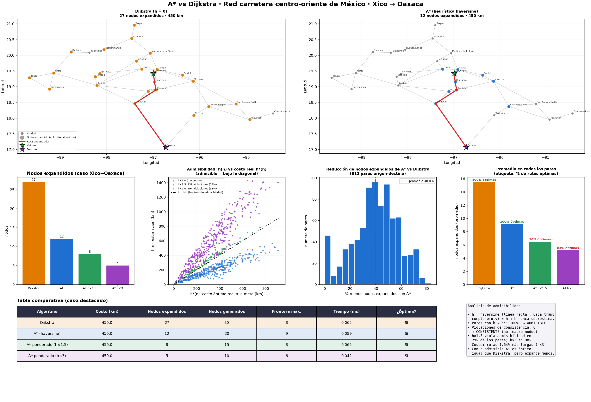

# A* vs Dijkstra en la red carretera del centro-oriente de México

Proyecto de la actividad **2.5 Búsqueda con heurísticas (A\* / Dijkstra)** — Russell & Norvig, cap. 3-4.

Se resuelve un caso real de **rutas por carretera** (29 ciudades con coordenadas GPS reales y 42 tramos
carreteros) con **Dijkstra** y **A\***, y se comparan sus métricas en un dashboard de matplotlib.
El caso destacado es **Xico (Veracruz) → Oaxaca**, pero el programa acepta cualquier par de ciudades.



## Entregables

| Requisito | Dónde está |
|---|---|
| Código Python | `src/` (`search.py`, `heuristics.py`, `analysis.py`, `graph_data.py`) y `main.py` |
| Dashboard (matplotlib) con métricas | `src/dashboard.py` → `output/dashboard.png` |
| Tabla comparativa A\* vs Dijkstra | `output/tablas.md`, `output/tabla_caso.csv`, `output/tabla_resumen.csv` |
| Análisis de admisibilidad | sección [Análisis de admisibilidad](#análisis-de-admisibilidad) + `output/admisibilidad_haversine.csv` |
| Pruebas automáticas | `tests/test_search.py` |

## Instalación y uso

```bash
git clone <URL-DE-TU-REPOSITORIO>
cd astar-dijkstra-mx
python -m venv .venv && source .venv/bin/activate      # Windows: .venv\Scripts\activate
pip install -r requirements.txt

python main.py                                          # Xico -> Oaxaca
python main.py --origen Xalapa --destino Tuxpan         # otro par de ciudades
python main.py --origen CDMX --destino Coatzacoalcos --repeticiones 500
pytest -q                                               # 9 pruebas
```

Salida en `output/`: `dashboard.png`, `tablas.md`, `tabla_caso.csv`, `tabla_resumen.csv`,
`admisibilidad_haversine.csv` y `benchmark_todos_los_pares.csv` (812 pares origen-destino × 4 variantes).

Ciudades disponibles: Xico, Coatepec, Xalapa, Perote, Huatusco, Cardel, Veracruz, Córdoba, Orizaba, Tehuacán,
Puebla, Tlaxcala, Apizaco, Teziutlán, Martínez de la Torre, Poza Rica, Tuxpan, Huauchinango, Tulancingo, Pachuca,
CDMX, Toluca, Cuernavaca, Cosamaloapan, Tuxtepec, San Andrés Tuxtla, Acayucan, Coatzacoalcos, Oaxaca.

## Modelado del problema

- **Estados:** ciudades. **Acciones:** viajar por un tramo carretero a una ciudad vecina.
- **Costo de paso:** kilómetros por carretera (aproximados). **Prueba de meta:** llegar a la ciudad destino.
- **Heurística:** `h(n) = haversine(n, meta)`, distancia en línea recta sobre la esfera terrestre.
- **Variantes comparadas:** Dijkstra (h = 0), A\* con haversine, y A\* ponderado con `h×1.5` y `h×3`
  (estas dos se incluyen a propósito para mostrar qué pasa cuando se rompe la admisibilidad).

## Métricas

- **Nodos expandidos:** los extraídos de la frontera y expandidos (la métrica principal de eficiencia).
- **Nodos generados:** los insertados en la frontera.
- **Frontera máxima:** memoria pico de la cola de prioridad.
- **Tiempo (ms):** mediana de varias repeticiones.
- **Costo y optimalidad:** costo de la ruta y si coincide con el óptimo de Dijkstra.

## Resultados (Xico → Oaxaca)

| Algoritmo | Costo (km) | Nodos expandidos | Nodos generados | Frontera máx. | ¿Óptima? |
|---|---|---|---|---|---|
| Dijkstra | 450.0 | 27 | 30 | 8 | Sí |
| A\* (haversine) | 450.0 | 12 | 20 | 9 | Sí |
| A\* ponderado (h×1.5) | 450.0 | 8 | 15 | 8 | Sí |
| A\* ponderado (h×3) | 450.0 | 5 | 10 | 6 | Sí |

Ruta óptima: Xico → Huatusco → Córdoba → Tehuacán → Oaxaca (450 km).

**Promedio sobre los 812 pares origen-destino:**

| Algoritmo | Expandidos (prom.) | Rutas óptimas | Sobrecosto máx. |
|---|---|---|---|
| Dijkstra | 15.5 | 100 % | 0 % |
| A\* (haversine) | 9.2 | 100 % | 0 % |
| A\* h×1.5 | 6.5 | 95.6 % | 10 % |
| A\* h×3 | 5.2 | 83.0 % | 48.8 % |

**Conclusiones**

1. A\* con haversine entrega **exactamente las mismas rutas óptimas** que Dijkstra, expandiendo **~41 % menos nodos**
   en promedio (56 % menos en el caso Xico → Oaxaca): la heurística dirige la búsqueda hacia la meta
   en lugar de explorar en círculos alrededor del origen.
2. En tiempo de reloj, A\* **no gana** en este grafo: con solo 29 nodos el costo de calcular haversine en cada
   generación es comparable a lo que se ahorra. La ventaja en nodos expandidos se vuelve ventaja en tiempo
   en grafos grandes (por ejemplo, la red completa de calles de una ciudad con OSMnx).
3. Inflar la heurística reduce más los nodos, pero **sacrifica la optimalidad**: con `h×3` el 17 % de las rutas
   salen subóptimas (hasta 48.8 % más largas).

## Análisis de admisibilidad

Una heurística es **admisible** si nunca sobrestima el costo real: `h(n) ≤ h*(n)` para todo nodo `n`.
Con una heurística admisible, A\* (versión de árbol) garantiza una ruta óptima.

**Argumento teórico.** La distancia haversine es la longitud del camino más corto posible sobre la superficie terrestre.
Ninguna carretera puede ser más corta que la línea recta entre sus extremos, por lo que
`w(u,v) ≥ haversine(u,v)` en cada tramo. Por la desigualdad triangular, para cualquier ruta
`n = n₀, n₁, …, nₖ = meta` se cumple `costo(ruta) = Σ w ≥ Σ haversine(nᵢ, nᵢ₊₁) ≥ haversine(n, meta)`.
Por tanto `h(n) ≤ h*(n)`.

**Consistencia (monotonía).** La misma desigualdad triangular da `h(u) ≤ w(u,v) + h(v)`. Una heurística consistente
es siempre admisible, y además garantiza que A\* nunca necesita reabrir un nodo ya expandido, por lo que `f(n)` es no decreciente a lo largo de cualquier camino.

**Verificación empírica** (se ejecuta en `main.py` y en `pytest`):

| Heurística | Pares con `h ≤ h*` | Violaciones de consistencia | Veredicto |
|---|---|---|---|
| haversine (×1.0) | **100 %** | **0** | admisible y consistente |
| haversine ×1.5 | 70.7 % | 281 | NO admisible |
| haversine ×3 | 2.2 % | 834 | NO admisible |

El dashboard lo muestra en el scatter `h` vs `h*`: los puntos azules (×1.0) quedan siempre bajo la diagonal
`h = h*`; los verdes (×1.5) y morados (×3) la cruzan, y es justo en esos casos donde A\* devuelve rutas más largas.

## Limitaciones y datos

- Las **distancias por carretera son aproximadas** (redondeadas a partir de rutas carreteras comunes, no un levantamiento
  oficial). Las coordenadas de las ciudades son reales. Antes de entregar puedes ajustar los kilómetros en `src/graph_data.py`
  con valores de Google Maps u OpenStreetMap; las pruebas te avisarán si algún tramo queda **más corto que la línea recta**
  (lo que rompería la admisibilidad).
- La red es una abstracción a nivel ciudad, no de calles. **Extensión sugerida:** cargar una red vial real con
  [OSMnx](https://osmnx.readthedocs.io/) (`ox.graph_from_place("Xalapa, Veracruz")`), convertirla a la misma lista de
  adyacencia `{nodo: [(vecino, metros)]}` y reutilizar `src/search.py` sin cambios.
- El grafo es no dirigido (todas las carreteras son bidireccionales) y no modela tráfico ni casetas.

## Estructura

```
astar-dijkstra-mx/
├── main.py                 # corre caso + benchmark + dashboard
├── requirements.txt
├── src/
│   ├── graph_data.py       # ciudades (lat, lon) y tramos (km)
│   ├── heuristics.py       # haversine y heurística ponderada
│   ├── search.py           # Dijkstra y A* instrumentados
│   ├── analysis.py         # admisibilidad, consistencia, benchmark
│   └── dashboard.py        # figura de matplotlib
├── tests/test_search.py
└── output/                 # dashboard.png, tablas, CSV
```

## Referencias

- Russell, S. & Norvig, P. *Artificial Intelligence: A Modern Approach*, caps. 3-4 (búsqueda informada y heurísticas).
- Hart, Nilsson & Raphael (1968). *A Formal Basis for the Heuristic Determination of Minimum Cost Paths*.
- Dijkstra, E. W. (1959). *A note on two problems in connexion with graphs*.

## Equipo
Fabian Andrade Hernandez
